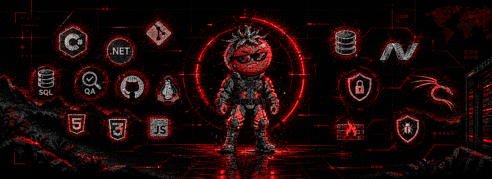

  

# Hola, soy Tomatitooou

💻 QA tester | SQL | programador C# · .NET  
🔐 Interesado en desarrollo web y ciberseguridad

## Sobre mí

En marzo de 2026 nació mi curiosidad por la programación eh QA y desde entonces
comencé a aprender de forma autodidacta.

Actualmente estoy enfocándome en QA y SQL , construyendo mis bases mediante
la práctica, aprender eh entender los conseptos mas que enfocarme por conseguir certificados.

Mi objetivo es avanzar progresivamente hacia el desarrollo web y,
posteriormente, profundizar en ciberseguridad.

## Actualmente aprendiendo de forma progresiva 

- C#
- .NET
- profundizar mas en programacion 
- Desarrollo web

# Mis Objetivos 
son aprender de lo que me gusta y rendir en eso lo mas que pueda 
Formarme profecionalmente de lo que me gusta 
y sobre todo saber de que cosas soy capas de hacer

